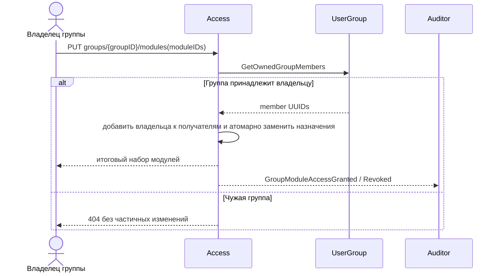
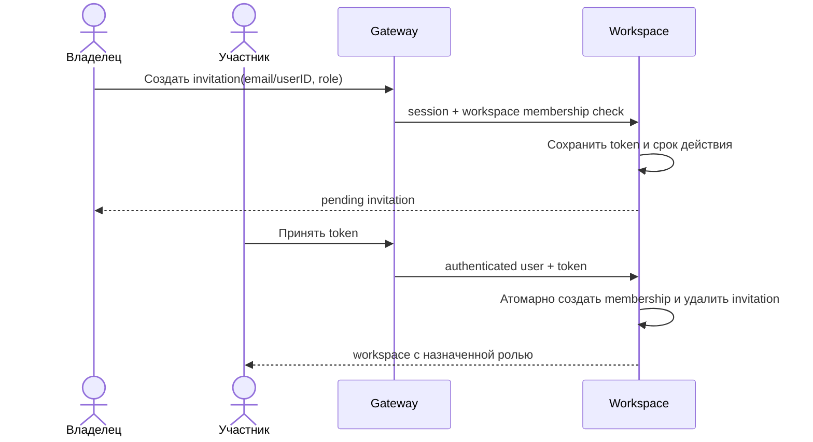
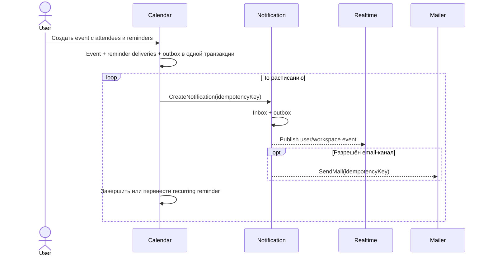
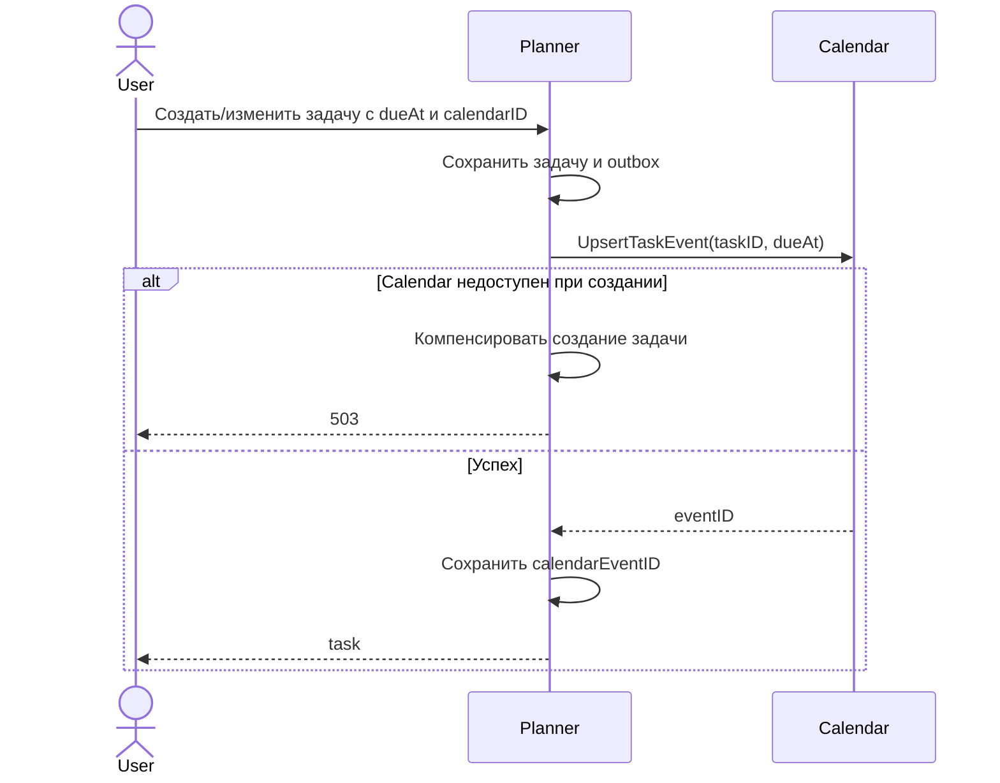
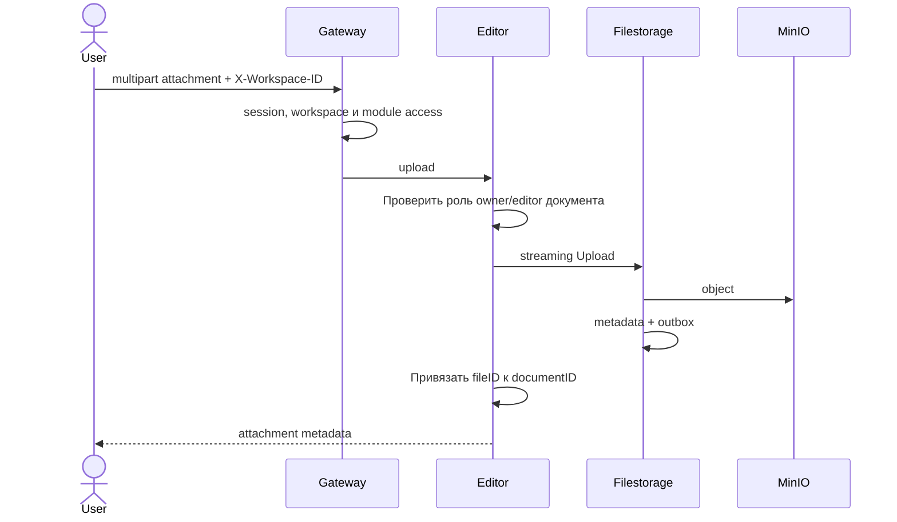
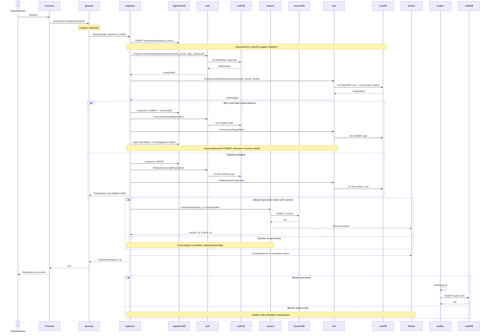
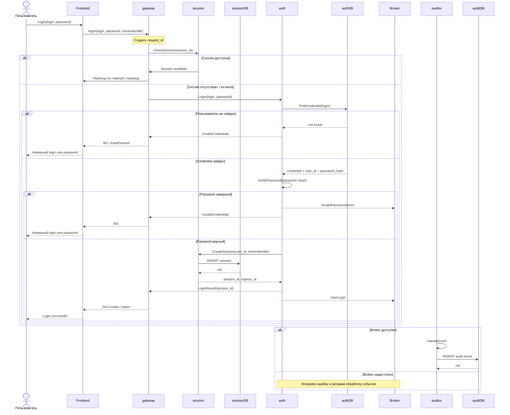
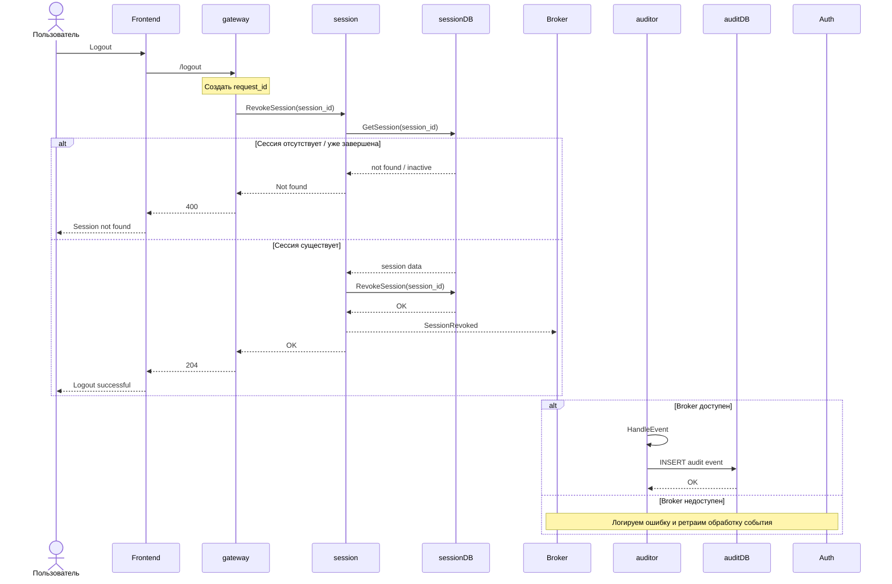
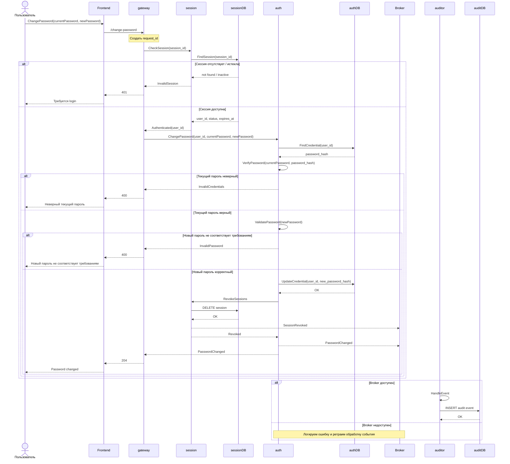

# Сценарии работы системы

## Назначение модулей группе пользователей

## Приглашение в рабочее пространство

## Напоминание календаря

## Задача с синхронизацией в календарь

## Вложение документа

`access` — единственный владелец назначений модулей группам. Каждый источник
«группа–модуль» хранится отдельно, поэтому отзыв одного источника не удаляет доступ,
который пользователь продолжает получать через другую группу. Изменения состава
группы добавляют или удаляют гранты всех её активных модулей, а владелец получает
их автоматически, даже если в группе ещё нет участников. Права на отдельные
ресурсы по-прежнему принадлежат соответствующим продуктовым сервисам.

## Регистрация пользователя

## Логинация пользователя

## Logout пользователя

## Смена пароля

